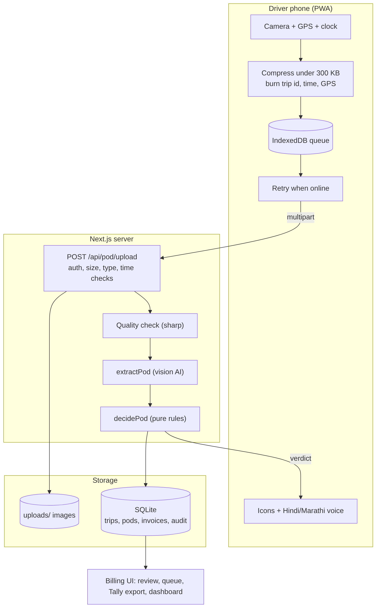
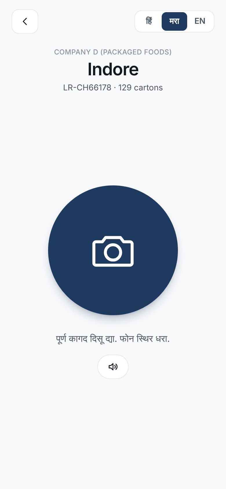
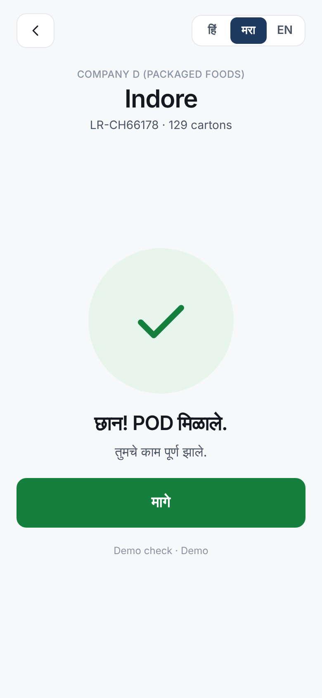
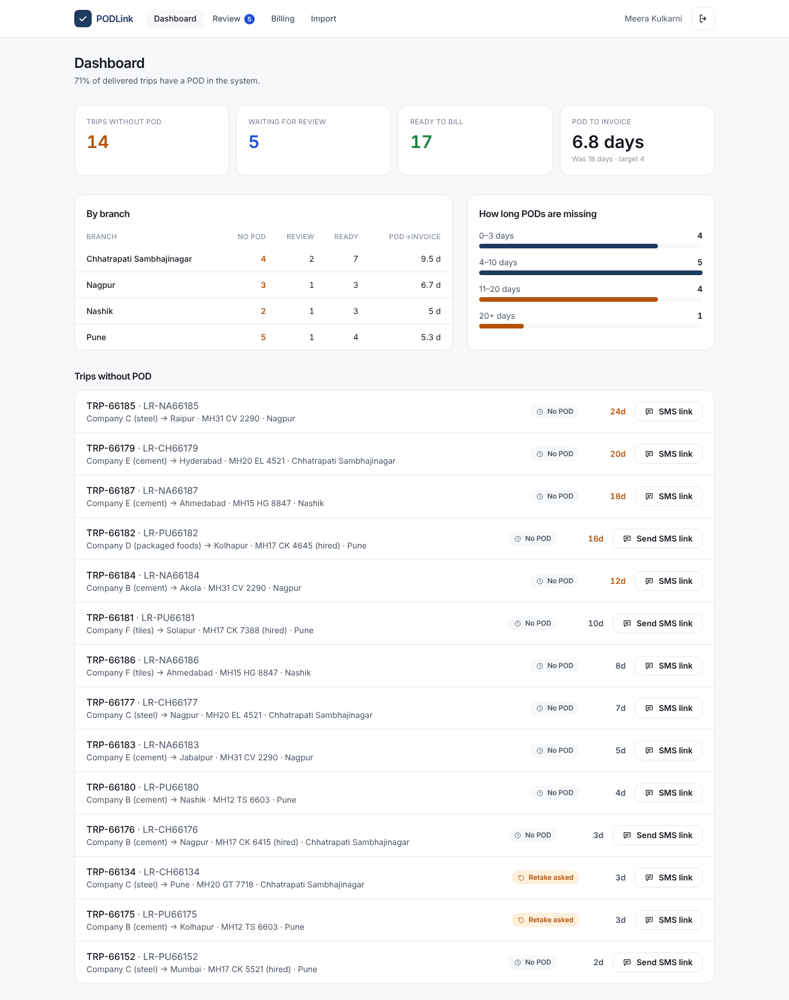
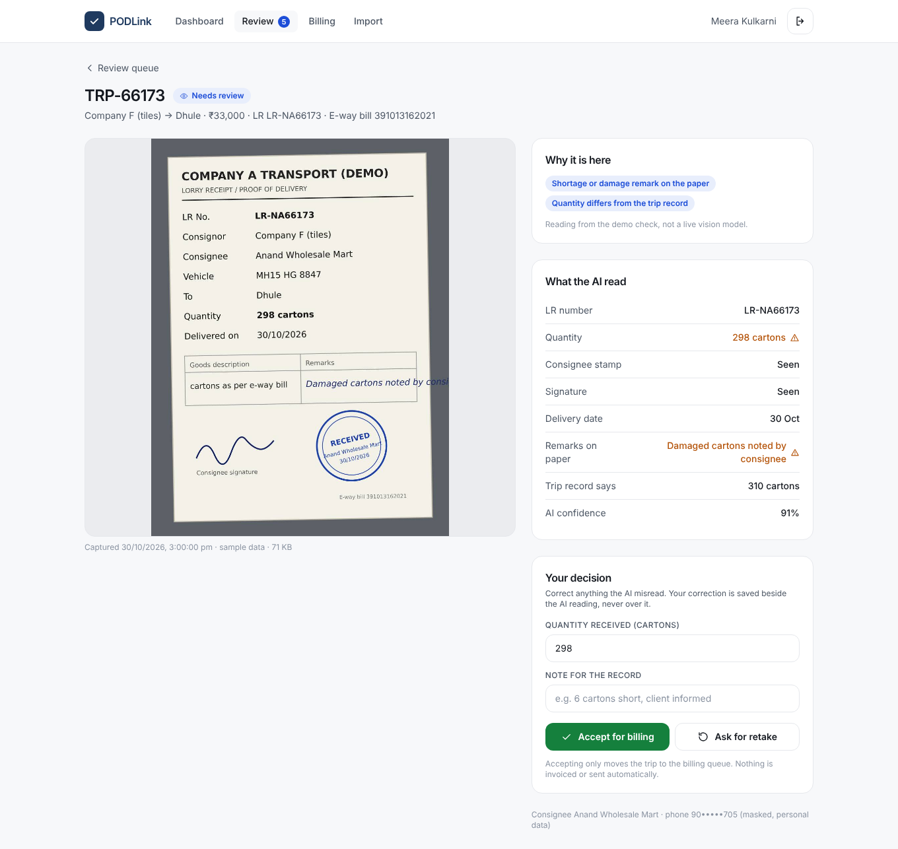
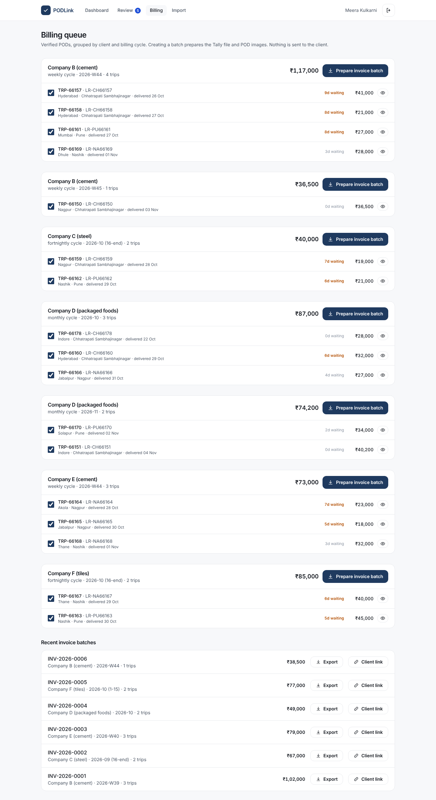

**GitHub:** <<ADD YOUR PUBLIC GITHUB URL HERE BEFORE SUBMITTING>>

**Live app:** not deployed. Run locally with the steps in `deployment.md`. Deployment instructions for a host with a persistent disk are in the same file.

Problem statement chosen: **5, Road transport fleet's proof-of-delivery capture and billing app** (Software Engineering core build).

# 1. What this builds and for whom

Company A moves full truckloads and cannot bill in Tally until a signed lorry receipt (LR) comes back, often 10 to 20 days after delivery. The core build in the brief is one slice working end to end:

driver POD capture, AI check with retake prompt, review queue, billing queue with export, and missing-POD dashboard, for two roles (driver and billing executive).

PODLink does that in eight screens: login, driver home, capture and result, review queue, review detail, billing queue, dashboard and trip import, plus two token pages (the hired-driver upload link and the read-only client link).

The brief's own numbers frame the goal: POD-to-invoice from 18 days to 4, PODs in the system within 24 hours of delivery for 80% of trips, and lost or disputed PODs from 1.5% to 0.5%. The dashboard shows the first two live (see section 7 for how the demo data relates to them).

# 2. Architecture and why

| Layer | Choice | Reason |
|---|---|---|
| App | Next.js 15 (App Router), React 19, TypeScript, Tailwind | One codebase and one deployable for the UI and the API. Server components keep dashboard queries off the phone. |
| Database | SQLite through better-sqlite3 | Zero set-up for a reviewer, transactional, fast for this size (2,200 trips a month is tiny). A Postgres swap is contained in `src/lib/db.ts` and `queries.ts`. |
| Auth | Signed cookie (jose, HS256), bcrypt hashes, two roles | Drivers use a code and 4-digit PIN on a big keypad because they do not type well. Office users use email and password. |
| Images | Compressed in the browser, stored on disk, served only through an authorised route | Meets the 300 KB limit before upload, which matters on highway signal. |
| AI | Vision model behind one function, `extractPod`, with a labelled demo fallback | Section 5. |
| Validation | Zod on every request body and on every AI answer | Nothing untrusted reaches the database unchecked. |

{width=3.2in}

**Two decisions worth defending**

1. *The AI reads, plain code decides.* The model only returns fields. Whether the driver is asked to retake, the trip goes to a person or the POD is accepted is decided by a pure function (`decidePod` in `src/lib/pod-rules.ts`) that is unit tested. That keeps the behaviour predictable, explainable in an interview and easy for the client to change.
2. *Offline first on the phone.* The photo is compressed, stamped and written to IndexedDB before any network call. Upload is a retry of that stored item, so a dead zone never loses a photo.

# 3. Data model

Seven tables (`src/lib/db.ts`).

| Table | Key fields | Notes |
|---|---|---|
| `users` | role (`driver` or `billing`), login, bcrypt `secret_hash`, language, branch | Language drives the voice prompts. |
| `clients` | name, `billing_cycle` (weekly, fortnightly, monthly), `tally_ledger` | Cycle decides how verified trips are grouped. |
| `trips` | id, `lr_no` (unique), `eway_bill_no`, client, vehicle, hired, driver, freight, qty, `pod_status`, `retake_count`, consignee name and phone, `invoice_id` | `pod_status`: none, retake_requested, needs_review, verified, billed. Every trip carries its e-way bill. |
| `pod_submissions` | image file, size, `captured_at` (device), `received_at` (server), lat, lng, accuracy, `captured_offline`, source (app, sms_link), `ai_mode`, `extraction_json`, `decision`, `reasons_json`, `corrected_json`, `client_ref` | One row per photo, so history is never overwritten. `client_ref` makes retries idempotent. |
| `invoices` | number, client, cycle label, total, `share_token` | One batch per client per cycle. The token powers the client link. |
| `sms_links` | token, trip, expiry | 72-hour, single-trip upload tokens for hired drivers. |
| `audit_log` | actor, action, trip, detail | Logins, failed logins, every decision and every correction. |

**Rule that matters:** the extraction and the human correction are stored in two different columns. The image stays the source of truth and a correction never replaces what the AI read.

# 4. Main flows

**Driver capture (app).** Sign in, pick the trip, tap the one big camera button. GPS is requested the moment the button is tapped. The photo is compressed in steps (long side 1600 px at quality 0.8, then lower quality, then smaller size) until it is under 290 KB. The trip id, time and GPS position are burned into the image. The result is saved to the device queue, sent, and the verdict comes back while the driver is still at the gate.

**Hired driver (SMS link).** Billing creates a link for one trip from the dashboard. It opens the same capture screen with no sign-in. The token is valid for that one trip only and expires after 72 hours. Sending the SMS is mocked: the link is shown on screen.

**Verdict.** Green tick (accepted), orange retake with icon reasons and a spoken prompt in Hindi or Marathi, or a neutral "sent to office" screen. Retakes are capped at two. After that the photo goes to a person instead of asking again.

**Review queue.** Everything with a shortage or damage remark, a quantity that differs from the trip, low confidence, a hit retake cap, or an AI failure lands here. The executive sees the photo beside what was read, the reasons, and can correct the quantity, add a note, accept, or ask for a retake (still bound by the cap of two).

**Billing queue and export.** Verified trips are grouped by client and billing cycle. The executive ticks trips and prepares a batch, which gets an invoice number. Export downloads a ZIP: a Tally Prime sales-voucher XML, a CSV of lines and the POD images named by LR number. Invoices are never sent automatically.

**Dashboard.** Trips without POD, waiting for review, ready to bill, POD-to-invoice days (with the 18-day baseline and 4-day target), a table by branch, an ageing view of missing PODs and a list with one-tap SMS link.

**Daily import.** A CSV of trips with LR and e-way bill numbers. Each row is validated (the e-way bill must be 12 digits), good rows are inserted or updated and bad rows are reported by line with the reason.

# 5. How the AI part works, and what happens when it is wrong

1. **Local quality check first** (`image-checks.ts`, sharp). Blur, darkness and cropping are measured on the server with deterministic code. If it finds a problem it overrides the model, so a blurry photo is always a retake no matter what the model says.
2. **Extraction.** The photo goes to a vision model with a strict prompt: read only what is visible, use null when unsure, return one JSON object (LR number, stamp present, quantity, remarks, shortage or damage flag, delivery date, signature present, image quality, confidence). The reply is validated with Zod. Anything that does not parse is treated as a failure.
3. **Decision** (`decidePod`), in this order:
   1. A shortage or damage remark always goes to a person, even if the photo is also poor, because it is a dispute risk.
   2. Anything the driver can fix at the gate (blurry, dark, cropped, LR missing or not matching, stamp, signature or date not visible) asks for a retake, up to two.
   3. Anything else uncertain (quantity differs from the trip, quantity unreadable, confidence below 0.75) goes to a person.
   4. Otherwise the POD is marked verified, which only places it in the billing queue.
4. **When it is wrong or unsure:**
   - Model timeout, network failure or invalid JSON: the trip goes to the review queue with reason "AI check failed". The driver is never blocked and nothing is auto-approved.
   - Model reads a field wrongly: the executive sees the image next to the reading and corrects it. The correction is stored beside the original.
   - Model is confidently wrong and passes a bad paper: this is the residual risk. The mitigation is that a verified POD still has to be turned into an invoice by a person, who can open the image from the queue.
   - Retake loop: capped at two, then a person decides.

**Demo mode.** Without an API key the app cannot truly read text, so it says so on screen ("Demo check"). It really measures image quality and detects blue stamp and pen ink by colour, and takes quantity, remarks and confidence from each trip's seeded scenario. The model path is written to the same interface and is switched on by setting `ANTHROPIC_API_KEY`. **I have not run the live model path against real PODs** because no key was available in my build environment, so its accuracy on real handwriting is untested.

# 6. UI and design decisions

The client asked for minimal, restrained design where every element has a purpose, and for drivers who do not read well. Two interfaces follow from that.

**Driver (phone first).** One screen, one action. The 224 px camera button is the only thing to press. There is no form anywhere. Outcomes use colour and a large icon first and text second: green tick, orange retake arrow, neutral upload. Each retake reason has its own icon (blur, sun, frame, stamp, pen, document, clock). Every screen speaks a short prompt in Hindi or Marathi using the phone's text-to-speech, with a speaker button to repeat it, and a three-way language switch (Hindi, Marathi, English). Login uses a number pad with PIN dots instead of a keyboard. When offline, an "Offline" pill appears and the result screen says the photo is saved.

**Billing (desktop first, works on a phone).** One navy brand colour, a white and cool-grey background, one sans-serif face, and colour kept for meaning only (orange for ageing and retakes, blue for review, green for ready). The dashboard leads with four numbers. The review screen is a two-column layout with the paper on the left and the facts on the right, so nothing needs to be remembered between looking and deciding. Every list has an empty state and a loading state, and errors are shown in plain words next to the action that failed. No horizontal scrolling was found at 390 px width.

{width=2.2in} {width=2.2in}

{width=6.2in}

{width=6.2in}

{width=5.2in}

# 7. Security, privacy and testing

- **No secrets in the repository.** `.env.example` lists names with placeholders. In production the app will not start without `SESSION_SECRET`. In development a random per-process key is used, never stored.
- **Access control.** Middleware guards `/driver` and `/billing`, and every API route checks the role again. A driver can upload only for their own trip. A token can upload only for its own trip and only before it expires. Billing endpoints return 403 to drivers and to nobody.
- **Input validation.** Zod schemas for every body. Uploads are checked for size (300 KB), real image type by file signature and a sane capture time. Image file names are generated by the server.
- **Abuse limits.** Login (10 per minute) and upload (60 per minute) are rate limited per IP, in memory.
- **DPDP Act 2023.** Consignee name and phone are personal data. They are shown to billing only on the review page, with the phone masked. They are not shown on the client link. The data model keeps them in the trip row only, so they can be deleted or anonymised in one place. All demo data is synthetic.
- **Audit.** Logins, failed logins, every POD decision and every correction are written to `audit_log`.
- **Tests.** 36 unit tests (Vitest) cover the decision rules including the retake cap and shortage precedence, billing cycle grouping, the Tally XML export, trip import validation and the compression step plan. I also ran the full flow by hand against a production build: offline capture and sync, retake cap, rejected files (not an image, oversized, wrong driver, signed out), review and correction, double-invoicing, mixed-client and mixed-cycle invoices, Tally ZIP, and CSV import with a bad row.

**Sample data.** The three trips in the brief are seeded exactly: TRP-66120 verified, TRP-66134 retake requested (stamp not visible), TRP-66141 needs review (short by 6 cartons). About 46 more trips are generated across four branches, five clients and the three billing cycles, with generated POD images. The dashboard's POD-to-invoice figure (about 7 days on a fresh seed) is computed from that synthetic data and is not evidence of the real result.

# 8. Assumptions (each one is mine, not from the brief)

1. Clients are billed on different cycles. The brief says "by client and cycle" but not which cycles, so I assumed weekly, fortnightly and monthly, assigned by client.
2. One invoice batch covers one client and one cycle. Trips from two cycles cannot be mixed.
3. Branches are Chhatrapati Sambhajinagar, Pune, Nagpur and Nashik. Only the first is named in the brief.
4. Tally Prime accepts the XML import format used, and the ledgers "Freight Income" and the client's ledger already exist. GST is added by Tally's own voucher set-up, so the export carries freight value only. Tally cannot embed images in an import file, so images travel in the same ZIP, named by LR number.
5. The confidence threshold of 0.75 is a starting value. It should be tuned on real PODs.
6. A quantity on the paper that differs from the trip record goes to review. Cement in bags and steel in tonnes are compared as whole numbers.
7. Hired-driver links last 72 hours. SMS delivery, and any payment, are mocked as the brief allows.
8. Drivers have Android phones with a camera and a Marathi or Hindi text-to-speech voice installed. Voice quality depends on the phone.
9. Driver PINs are 4 digits for usability. This is weak on its own and is mitigated only by rate limiting.
10. The 300 KB limit is applied to the compressed upload, enforced in the browser and again on the server.
11. Data is stored in India or wherever the chosen host runs. A real deployment needs a data-residency and consent decision for the DPDP Act.

# 9. What I cut, known limits, and what I would do next

**Cut (outside the core build)**

- Real SMS sending, real e-way bill lookup and a real Tally connection (all mocked or file based).
- Multi-branch permissions: any billing user sees every branch.
- Live GPS tracking, trip planning and expenses, which are out of scope in the brief.

**Known limits, stated honestly**

- The live vision path is untested on real documents (see section 5).
- Demo mode cannot read the paper. Its output is labelled, but a reviewer should not treat it as accuracy evidence.
- SQLite and the in-memory rate limiter mean one server instance. Scaling out needs Postgres and a shared limiter.
- Images are on local disk, not object storage.
- The browser voice prompts rely on the phone's own speech engine. If the phone has no Hindi or Marathi voice, the text and icons still carry the message but there is no sound.
- GPS is stamped and stored but not checked against the consignee's location. A driver could photograph a paper somewhere else. The stamp makes that visible to a reviewer but nothing blocks it.
- A driver can upload another photo for a trip that is already waiting for review. It is kept as extra evidence but does not change the retake count.
- Automated tests cover logic, not the browser. There are no automated end-to-end tests.

**Next**

1. Run the model on 100 real PODs, compare with human readings, then set the confidence threshold and the shortage wording from data.
2. Real SMS (with a template approved for the sender), delivery status and a resend button.
3. Geofence check against the consignee's address and a duplicate-photo check.
4. Postgres and object storage, a retention rule for images and consignee data, and a consent notice for drivers.
5. Branch-scoped billing roles and an operations-head view with trends against the 18-to-4-day target.
6. Playwright end-to-end tests for the driver offline flow.
